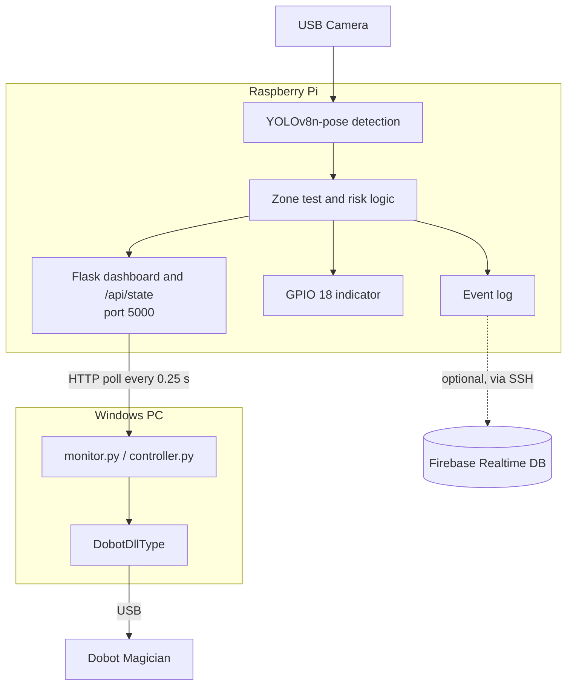

# AI Industrial Safety Monitoring and Control

A vision-based safety system for a robotic work cell. A camera watches the area around a **Dobot Magician** robot arm, a **Raspberry Pi** runs YOLOv8 pose estimation to decide how risky the situation is, and a **Windows PC** stops the robot whenever a person (or a hand) gets too close.

The project grew from a virtual-fencing intrusion detector (still included in `legacy_mac_fencing/`) into a full safety loop: **detect → assess risk → stop the robot**.


> Full demo video: [

https://github.com/user-attachments/assets/390073da-2875-4f4d-8ce4-4877a484b03a

]

> **Disclaimer:** This is an academic prototype. It is *not* a certified safety system and must not replace a hardware emergency stop or any standards-compliant safeguarding.

---

## Features

* Real-time person detection and **pose estimation** (YOLOv8n-pose) on a Raspberry Pi
* Three configurable zones: **safe, warning and danger**
* **Body-part awareness**: a wrist entering the danger zone triggers a stop even if the body is outside it
* **Motion prediction**: estimates velocity and predicts where the person will be 0.5 s ahead
* Risk levels (LOW / MEDIUM / HIGH) mapped to robot states (NORMAL / SLOW / STOP)
* **Fail-closed robot control**: the Dobot only moves when the Pi reports NORMAL + LOW; unreachable or unknown state means stop
* Live web dashboard with video stream, system status, zone editing and event logs
* GPIO output (pin 18) for a physical indicator: [TODO: buzzer / relay / LED?]
* Event logging with timestamps, plus an optional Firebase cloud logger

---

## System Architecture



---

## Repository Structure

| Folder / file | Purpose |
|---|---|
| `raspberry_pi/` | **Main AI system.** `project1.py` runs camera + YOLO + risk logic + GPIO; `app.py` serves the dashboard and API; `fence_config.json` holds the zone polygons |
| `windows/` | **Robot side.** `DobotDllType.py` (Dobot SDK wrapper), `monitor.py`, `controller.py`, `controller_loop.py` |
| `dobot_studio/` | `demo.playback`, a route recorded in Dobot Studio, kept for reference |
| `firebase/` | Optional cloud logging: example config and reference scripts |
| `legacy_mac_fencing/` | The original fencing-only project (two rectangular zones, YOLOv8s, runs on a laptop) |
| `historical/` | Earlier iterations of the Pi and controller code, kept for reference |
| `media/` | Screenshots, demo GIF |

---

## Hardware

* Raspberry Pi 4 with a camera (USB webcam) and optional display
* Dobot Magician (USB connection to the Windows PC)
* Windows PC on the same network as the Pi
* [TODO: GPIO 18 device, e.g. buzzer or relay, and how it is wired]

---

## Setup and Running

### 1. Raspberry Pi

```bash
cd raspberry_pi
pip install -r requirements.txt
python3 app.py
```

The YOLO model (`yolov8n-pose.pt`) is downloaded automatically on first run. Open the dashboard at `http://<pi-ip>:5000`.

### 2. Windows PC

1. Install the Dobot driver / Dobot Studio and copy `DobotDll.dll` and its dependency DLLs from Dobot's SDK into `windows/` (they are not included in this repo).
2. Set the Pi address at the top of the script you use:
   ```python
   PI_URL = "http://<pi-ip>:5000/api/state"
   ```
3. Run one of the scripts:

| Script | What it does |
|---|---|
| `monitor.py` | Only watches the Pi. Sends a stop command to the Dobot when the state is STOP / risk HIGH, or when the Pi connection is lost |
| `controller.py` | Runs the saved route **once**, point by point, re-checking the Pi state before and during every move |
| `controller_loop.py` | Same as `controller.py` but repeats the route continuously |

Set `MOTION_ENABLED = False` to test without moving the arm, and `TEST_ONE_POINT = True` to test a single point first.

> The controllers halt permanently once an unsafe state occurs. Restart the script to resume.

### 3. Firebase (optional)

Copy `firebase/config.example.json` to `firebase/config.json`, fill in your own values, and **never commit it**. The scripts in `firebase/` are reference implementations that read the Pi event log over SSH and upload events to Firebase Realtime Database. [TODO: confirm tested or untested]

### 4. Legacy fencing version (optional)

```bash
cd legacy_mac_fencing
pip install opencv-python numpy ultralytics flask
python Main.py
```

---

## How It Works (Theory)

### 1. Detection and pose estimation
Each frame goes through **YOLOv8n-pose**, which returns a person bounding box plus 17 COCO keypoints. The system uses the box centre as the person's position and three keypoints (nose, left wrist, right wrist) for body-part checks.

### 2. Virtual zones and the point-in-polygon test
Zones are polygons stored in `fence_config.json` and can be edited from the dashboard. A point is classified with OpenCV's `pointPolygonTest` (a ray-casting test), checked in the order **danger → warning → safe → outside**.

### 3. Velocity and prediction
Speed is estimated from the change in the person's centre between frames:

```
v = (p_now − p_prev) / Δt        p_predicted = p_now + v × 0.5 s
```

The predicted point is also tested against the zones, so the system can react *before* the person enters the danger zone. A direction score (cosine between the velocity and the direction to the danger zone) above 0.25 flags "moving toward danger".

### 4. Risk assessment

| Condition | Risk | State |
|---|---|---|
| Wrist or body inside the danger zone | HIGH | STOP |
| Predicted position enters the danger zone | HIGH | STOP |
| Inside the warning zone (moving toward danger or not) | MEDIUM | SLOW |
| Safe zone or outside the monitored area | LOW | NORMAL |

### 5. Fail-closed robot control
The Windows controllers read `/api/state` several times per second. They allow motion only for **NORMAL + LOW**. Any other state, an unknown value, a timeout or a lost connection triggers `SetQueuedCmdForceStopExec` and clears the Dobot command queue.

### 6. Running on an edge device
To stay real-time on a Raspberry Pi 4: 320×240 capture, 256 px inference size, every 2nd frame processed, the nano model, a single camera thread feeding a Flask MJPEG stream.

---

## Dashboard

The Pi dashboard shows the live annotated video, system status (camera, YOLO), zone editing controls, current zone/risk/state and recent event logs.

| Hardware setup | Intrusion view | Pi dashboard |
|---|---|---|
|  |  |  |

---

## Limitations

* Only the first detected person is tracked
* One 2D camera: no depth, and speed is in pixels per second, not metres per second
* Total reaction time = inference time + 0.25 s polling over Wi-Fi + the Dobot stop command
* The stop is a software command, **not** a certified emergency stop
* The Flask API has no authentication, so anyone on the network can read the state or change the zones
* Accuracy depends on lighting, camera angle and occlusion
* The Pi address is configured by hand in each Windows script

## Future Scope

* Multi-person tracking with IDs
* Depth camera / stereo for real distance measurement
* Hardware emergency-stop integration
* Authenticated API and encrypted communication
* Automatic safe resume after the area is clear
* Multi-camera coverage and cloud dashboard

---

## Author

Ananya Barde

[TODO: aishwaray bhagwat / dr pankaj jain ]

## License

See [LICENSE](LICENSE).
